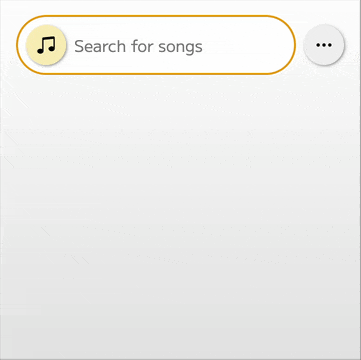
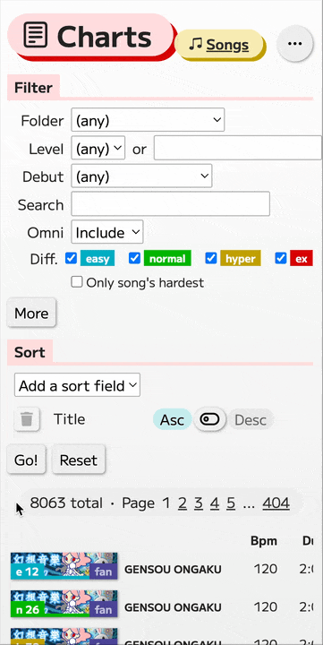
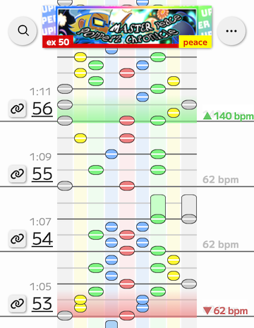
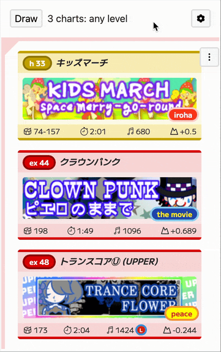

# Pop'n Tools

Suite of mobile-first, URL-friendly web apps for exploring [Pop'n Music](https://en.wikipedia.org/wiki/Pop%27n_Music) arcade game metadata, plus a randomizer for tournament matches (used at almost every major North American Pop'n Music event since 2018). Live at [popn.tools](https://popn.tools).

## Quick search app

Search as you type — perfect for finding _that one song_ whose title you can't remember. Indexes on song metadata (title, genre, artist, level, etc.) to perform full-text search.

**[popn.tools/search](https://popn.tools/search)**



## Full search app

Exhaustive search — for powerful SQL-style queries. Supports fine-grained filtering and sorting by multiple fields.

**[popn.tools/songs](https://popn.tools/songs)**



## Chart viewer app

See charts exactly how they appear in-game — bpm changes, hold notes, and all. Supports bpm change cancellation, note mods (mirror, random, etc.), and rhythm-based note coloring.

**[popn.tools/chart/[title]/[difficulty]](https://popn.tools/chart/oto/ex)**



## Randomizer app

Fetch a random sample of songs — tailored for tournament matches but great for casual play too. A staple at major North American Pop'n Music tournaments.

**[popn.tools/randomizer](https://popn.tools/randomizer)**



## Data and architecture

### Stack

- **Frontend:** Next.js, React, TypeScript, SCSS, SWR for data fetching
- **Backend:** Rails JSON API, SQLite (**[popn-search-api](https://github.com/fishluv/popn-search-api)**)
- **URL state:** use-query-params — search filters and chart viewer options are all encoded in the URL, so any view is shareable and bookmarkable
- **Tooling:** ESLint, Prettier, Yarn, Node
- **Hosting:** Vercel (main app — this repo), Render (**[popn-search-api](https://github.com/fishluv/popn-search-api)**), Cloudflare CDN (chart viewer data and other assets)

### Data

- Raw song and chart metadata are compiled from community sources ([bemaniwiki](https://bemaniwiki.com), [popn.wiki](https://popn.wiki), [RemyWiki](https://remywiki.com)).
- Data is normalized, repackaged into SQLite and JSON, and distributed at **[popn-dbs](https://github.com/fishluv/popn-dbs)**.
- Search apps consume SQLite data via the **[popn-search-api](https://github.com/fishluv/popn-search-api)** Rails API server.
- Randomizer app consumes JSON data via the **[popn-db-js](https://github.com/fishluv/popn-db-js)** JS client.

### Code layout

| Directory     | Purpose                                                  |
| ------------- | -------------------------------------------------------- |
| `pages/`      | App routes and entrypoints                               |
| `components/` | Shared and app-specific UI                               |
| `models/`     | Domain classes, utility types, and related parsing logic |
| `lib/`        | Fetching, local storage, and other utilities             |
| `styles/`     | Global styling and color system                          |

## Notable engineering

- **Chart viewer rendering:** Notes, bpm markers, and beat lines are drawn using DOM elements, measure by measure. To match in-game behavior, time-to-pixels mapping is bpm-dependent, and just as bpm changes can occur mid-measure, this mapping must also be dynamically recalculable.

- **Separate per-app data access patterns:** Search needs full-text indexing and flexible queries, so it runs against a Rails + SQLite API. The randomizer has simpler filtering needs, so it consumes JSON directly through a client library with no server round-trip. (Offline caching is planned.)

- **URL as the source of truth for state:** Search filters, sorting, and chart viewer options are all serialized into the URL, so any view can be shared or bookmarked, which matters for an online-first community that swaps links constantly.

- **Multi-source data pipeline:** Pop'n Music has 2000+ songs and 8000+ charts; metadata is scattered across community wikis with differing notions of a song's "primary key" and inconsistent handling of casing, spacing, CJK/special characters, and so on. [popn-dbs](https://github.com/fishluv/popn-dbs) normalizes the data into a single SQLite + JSON release so all apps consume one canonical dataset.

## Development

```sh
# Run Next.js development server on port 3001 (set in package.json)
nvm use
yarn
yarn dev
```

The search apps require the search API server to be running, on port 3000 (set in `.env.development`). See **[popn-search-api](https://github.com/fishluv/popn-search-api)** for instructions.

The chart viewer app does not require the search API server, but _does require an internet connection_, as chart data is fetched from a Cloudflare CDN.

The randomizer app can be run locally. (Song banner images are fetched from Cloudflare but are purely cosmetic.)
